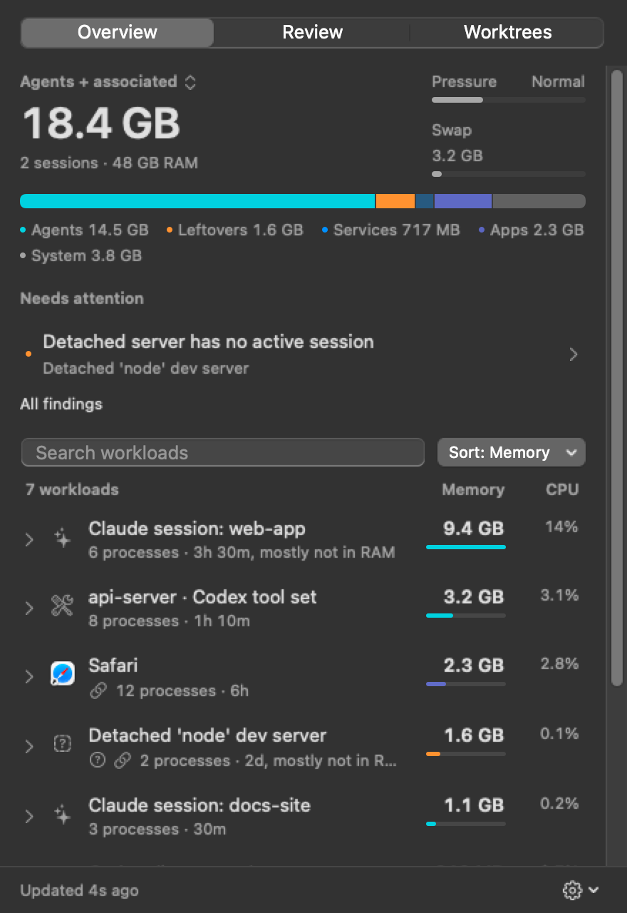
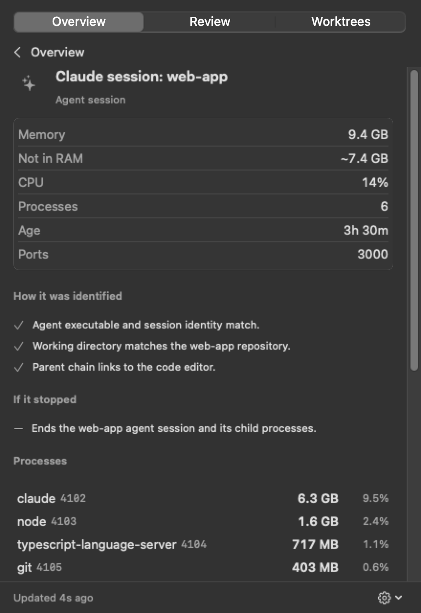
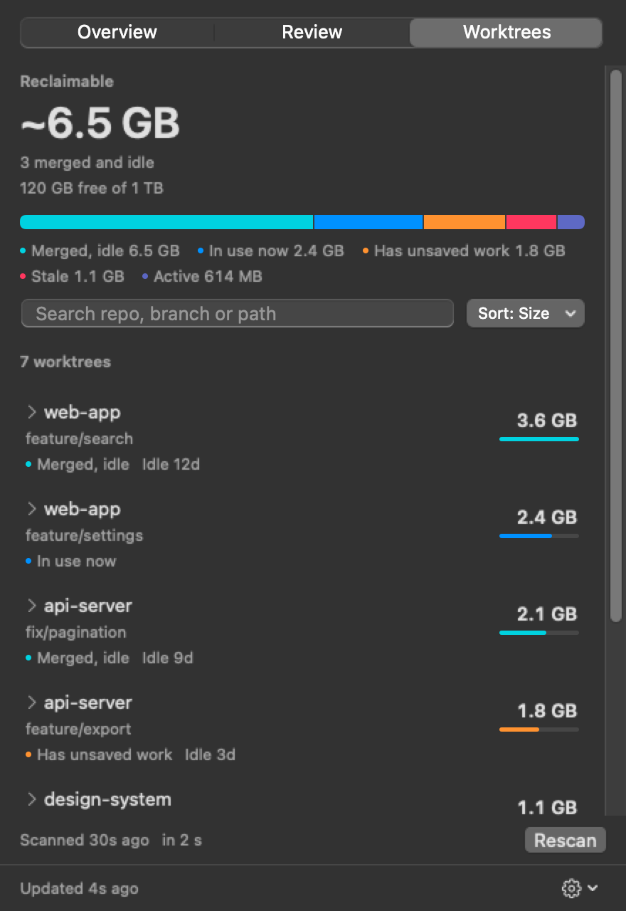

# procwho

See which work owns each macOS process. Inventory git worktrees discovered in chosen
folders, agent worktree folders, repositories with running agent sessions, and remembered
repositories.



## What it answers

- Which app, service, or agent session owns this process?
- How much memory and CPU does that workload use?
- Which processes look detached, and what evidence supports that finding?
- Which git worktrees have changes, live processes, or merged branches?

## Install

macOS only: the CLI requires macOS 13+, and the menu bar app requires macOS 14+.
Apple silicon is tested. Intel is built but untested.
Release archives contain universal Apple silicon and Intel executables.

```sh
brew install buddyh/tap/procwho            # CLI
brew install --cask buddyh/tap/procwho     # menu bar app (Procwho.app)
```

To uninstall, run `brew uninstall procwho` or `brew uninstall --cask procwho`.

<details>
<summary>Manual download</summary>

Download the app zip or CLI archive from
[Releases](https://github.com/buddyh/procwho/releases). Check `SHA256SUMS` before use.
Unzip the app and drag `Procwho.app` to Applications. For the CLI, download the
archive and checksum file into the same folder, then run:

```sh
shasum -a 256 procwho-0.1.0-macos-universal.tar.gz
# Compare with the matching line in SHA256SUMS.
tar -xzf procwho-0.1.0-macos-universal.tar.gz
mkdir -p ~/.local/bin
install -m 755 procwho ~/.local/bin/procwho
export PATH="$HOME/.local/bin:$PATH"
procwho --version
```

For future zsh sessions, add `export PATH="$HOME/.local/bin:$PATH"` to `~/.zshrc`.

</details>

<details>
<summary>Build from source</summary>

To build from source, use Rust 1.88 or later and Xcode 16.4 or later (Swift 6.1.2+, Swift 6 language mode).
Matching Command Line Tools alone can build the macOS app with SwiftPM and `bundle.sh`;
full Xcode is required for the universal release packaging command. No simulator is needed. Install Rust first using [rustup](https://rustup.rs/).

```sh
git clone https://github.com/buddyh/procwho.git
cd procwho
export PATH="$HOME/.cargo/bin:$PATH"
make build       # target/release/procwho
make test        # Rust and Swift tests
make app         # app/build/Procwho.app
make install     # CLI to ~/.local/bin/procwho
make install-app # optional app copy to /Applications; no sudo
```

`make uninstall` removes the installed CLI. Remove the app manually. Local history
and configuration are retained. No installer creates a launch agent.

</details>

## A 60-second CLI tour

These are trimmed, invented examples. PIDs and totals will differ on your Mac.

```console
$ procwho top -n 3
    MEM   CPU% PROCS     AGE  KIND           IDENTITY CONFIDENCE   WORKLOAD
  1.2 G   12.4     7     18m  agent-session  identity: high       Codex
  840 M    1.2    12      2h  app            identity: exact      Safari
  215 M    0.0     3     42m  agent-toolset  identity: medium     api-server · Codex tool set
```

`why` explains ownership, ancestry, confidence, and the effect of a workload's
children. It reports evidence and reveal suggestions; it does not stop anything.

```sh
procwho status                 # one snapshot and system totals
procwho findings               # review possible leftovers and unusual usage
procwho unknown -n 10          # inspect weak or missing ownership evidence
procwho tree "$$"              # process ancestry for this shell's workload
procwho status --json          # structured data for scripts
procwho worktrees --no-size    # git state and live use, without a disk scan
procwho --help
```

Workload memory is process footprint, including compressed pages. Sums can count shared
memory twice; they are not physical RAM use. CPU is a percentage of
one core; a multithreaded workload can exceed 100%. Unknown facts stay unknown.

## Name your own processes

Use **Copy naming rule** in workload detail or `procwho why <target> --rule`,
then paste it into your registry and give it a name. Procwho does not write this
file. See [owner rules and PROCWHO_OWNER](docs/CONFIGURATION.md#owner-rules)
for a complete example.

## Menu bar app

The Swift app shows workloads, findings, and worktrees. Open a workload for its
processes, ownership evidence, and findings. Settings control refresh, presentation,
worktree scan roots, and optional local alerts. The bundled CLI supplies the data.
The app does not require a background daemon. Alerts and launch at login default to off.
Overview ranks all visible families together; optional family grouping ranks groups
by the same metric. System workloads are hidden by default with a Show footer.
The Overview headline defaults to **Agents + associated**: agents, known host
apps and workloads linked by launching evidence, each process counted once. Click
the number or its chevrons to cycle through **Agents**, **Memory used**, and back.
Memory used comes from macOS VM counters, with available RAM and kernel pressure;
the default uses this view when no agents are detected. Medium-confidence linked
bytes have a separate ~ caption. The composition strip highlights the selected
view while keeping its attributed-memory denominator. Menu bar settings can follow
the panel or select any of these views. Agent sessions, helper groups and host
apps have separate counts. Unknown owner is distinct
from detached Leftovers. The "~mostly not in RAM" badge is an estimate.
Composition strips state their measured totals. Swap shows used bytes with a RAM-relative
meter; detail CPU shows sample age or Not sampled. Worktrees supports
search, sorting, visible filters and size measurement ages. Notification permission
is separate from the app's Alerts switch.

Swap shows bytes in use. macOS creates more swap files on demand, so allocated swap
is labelled **allocated so far**, never as a capacity limit. The meter compares use
with installed RAM; pressure, high swap relative to RAM, and low disk space set its colour.
The optional **Swap above N GB** alert starts at Automatic (25% of RAM, at least 2 GB),
with a separate critical-memory-pressure condition. Alerts remain off until enabled.



## Agents and MCP

Run `procwho mcp` for a read-only MCP server over stdio. Agents can inspect workload
ownership and worktrees through bounded, redacted tool output. See
[Agents and MCP](docs/AGENTS.md) for setup, tool arguments, and CLI JSON recipes.

## Worktrees

```sh
procwho wt --root ~/code
procwho wt --verdict merged-idle -n 100
procwho wt --all --no-size
procwho wt --json > worktrees.json
```

The app asks **Where are your projects?** at the first scan, with repository counts,
a folder picker, and a clear permission note for Documents/Desktop. Those protected
folders are never probed or scanned by default. Reopen **Choose folders…** in Worktrees settings.
The CLI offers `procwho worktrees --suggest-roots --json` for scripts.

Running agent sessions seed repositories wherever your projects live. Procwho also
searches verified agent worktree containers and keeps up to 500 repository roots in
its own state for later scans. `worktrees --forget-known` clears that memory.
See [discovery and automatic containers](docs/WORKTREES.md).

The inventory combines git status, merge evidence, disk estimates, and process cwd
use. Labels such as `in-use`, `has-work`, and `merged-idle` include reasons. They
are review labels, not deletion instructions. Git facts are only as fresh as the
repository's last fetch; procwho never fetches. APFS clone sharing means summed
sizes can exceed the space that removal would recover.



`procwho wt --pr` is an explicit network exception: it asks the installed `gh`
CLI for merged PR metadata. It sends the repository's remote owner/name. Leave it
off for local-only inspection.

## Supported agents

Recognition does not guarantee a session ID. Verified means installation evidence was
observed; it does not mean every mode ran on a real install. Documentation-only rules
have synthetic tests. See [Supported agents](docs/SUPPORTED-AGENTS.md) for exact paths,
mode guards, sources, confidence and verification limits.

| Agents | Verification | Scope and identity limits |
|---|---|---|
| Claude Code, Codex | Verified installation and host evidence | CLI/embedded sessions and shared hosts; explicit validated IDs where available |
| Cursor, Gemini CLI, Google Antigravity, Grok CLI | Verified installation | CLI/package paths; guarded editor/backend hosts; no live Cursor agent chain verified |
| OpenCode, pi, Cline, Droid / Factory | Verified installation | Scoped native/package runtimes; explicit IDs; selected server modes |
| Windsurf / Cascade, Crush | Verified component/launcher | Shared backend or package runtime; no live Cascade session or dynamic Crush native-child join verified |
| T3 Code | Verified running host/provider chains | Shared host and provider descendants; host-thread context stays separate from provider session ID |
| Kiro, Amp, Aider, Goose, GitHub Copilot CLI | Documentation-only | Guarded CLI modes/paths; session ID support varies |
| Zed external agents, Conductor | Documentation-only | Recognized provider descendants and app ancestry; no individual native editor conversation join |
| Qwen Code, Kilo Code, Continue, Devin local CLI, Auggie | Documentation-only | Scoped CLI/package paths; server modes and explicit IDs only where documented |

## Read-only and privacy

procwho does not stop, signal, restart, or delete observed processes, services,
repositories, or worktrees. It can write its own bounded history, caches, and isolated
temporary git objects. An explicit export writes to the requested destination. It has no cleanup command.

Secrets in argv and untrusted labels are redacted before display or storage. procwho does not
dump environments or read conversation transcripts. A small allowlist of
environment keys supplies agent identity evidence. No telemetry is sent. Normal
inspection stays local; the optional `wt --pr` lookup is described above.

Paths, process names, and project labels can still reveal personal context. Review
output before sharing it. Report redaction leaks through
[private vulnerability reporting](https://github.com/buddyh/procwho/security/advisories/new).

## Configuration

`procwho config` shows resolved settings and their sources.
`procwho config --example` prints an example. Configuration is optional and can
set worktree roots, label providers, and extra agent rules. See
[Configuration and label providers](docs/CONFIGURATION.md) for the file format and limits.

History and caches default to `~/.local/state/procwho/`. Configuration defaults to
`~/.config/procwho/config.json`. No label providers run unless configured.

## Reference

- [CLI commands and units](docs/CLI.md)
- [JSON schemas](docs/JSON.md)
- [Worktree verdicts, discovery and limits](docs/WORKTREES.md)
- [Configuration and label providers](docs/CONFIGURATION.md)
- [App development](app/README.md) and [release packaging](docs/RELEASING.md)

## How it works

The Rust workspace collects macOS process facts, joins ownership evidence, and
groups processes into workloads. The CLI exposes text, JSON, and MCP output. The
Swift menu bar app reads the CLI's JSON. See [Architecture](docs/ARCHITECTURE.md) for
data sources, precedence, confidence, redaction, and failure behavior.

## Limitations

- macOS only.
- Snapshots cannot see processes that start and exit between observations.
- Not in RAM is `max(footprint - RSS, 0)`. It is not measured per-process swap.
- Other users' processes are opaque where macOS denies access.
- Agent executable recognition does not always identify an individual session.
- Findings depend on available evidence and do not prove a process is disposable.

## Licence

MIT. See [LICENSE](LICENSE).

For plain explanations of workload labels, measurements, confidence and worktree verdicts, read [What the labels mean](docs/GLOSSARY.md).
